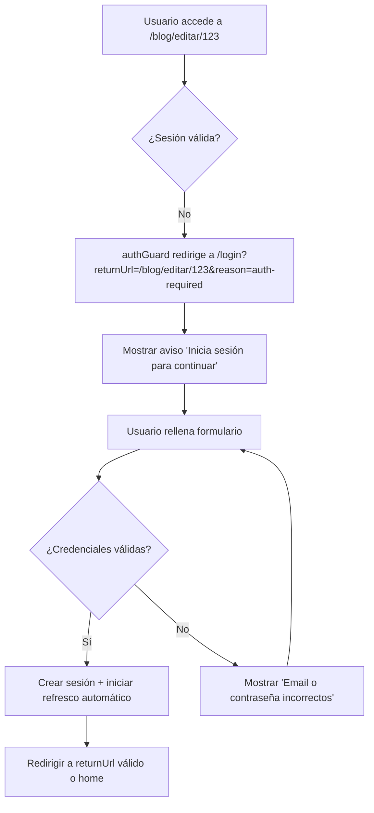
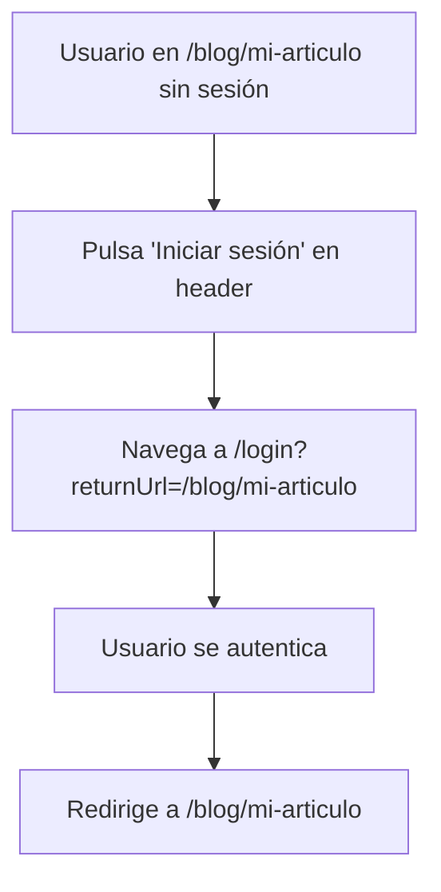
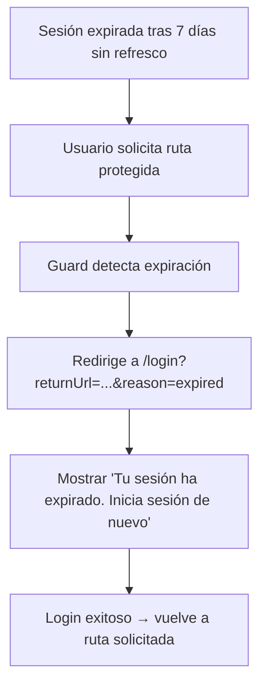
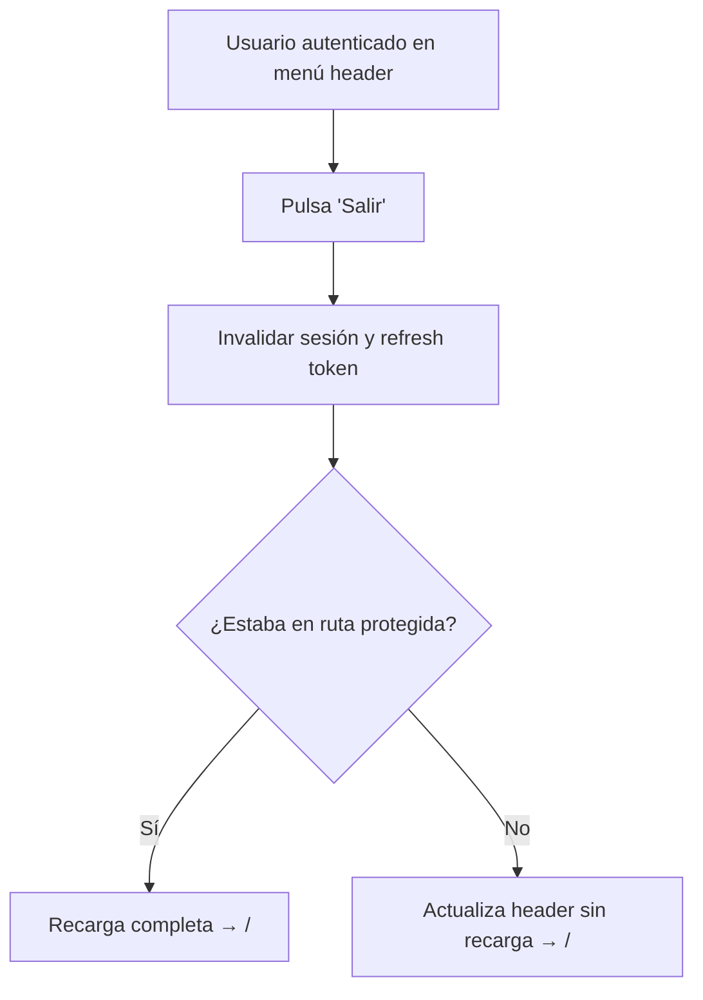

# 02. Diseño UX/UI — Login (Autenticación)

| Campo | Valor |
| :--- | :--- |
| **Feature** | `login` |
| **Fase** | MVP (Fase 1) |
| **Estado** | Diseño para revisión — listo para arquitectura/implementación |
| **Fecha** | 31/10/2026 |
| **Basado en** | `.context/features/login/01-product-manager.md` |
| **Guía de estilo** | `docs/GUIA-ESTILO.md` |

---

## 1. Objetivo de diseño

Diseñar la experiencia de autenticación con email y contraseña para proteger las rutas de edición y preview del blog, manteniendo la estética editorial-cafetera del sitio. El enfoque es minimalista, claro, accesible y sin añadir complejidad innecesaria al MVP.

---

## 2. Arquitectura de Información (AI)

### 2.1 Mapa de navegación

```text
┌─────────────────────────────────────────────────────────────┐
│ Header (sticky)                                              │
│ ├─ Brand (link a /)                                          │
│ └─ Auth state                                                │
│    ├─ Sin sesión: [Iniciar sesión] → /login                │
│    └─ Con sesión: [Nombre ▼] → menú con [Salir]            │
└─────────────────────────────────────────────────────────────┘

Rutas públicas (sin autenticación requerida)
├─ / (Home)                        — accesible siempre
├─ /blog                           — índice público (futuro)
└─ /blog/:slug                     — detalle público (futuro)

Ruta de autenticación
└─ /login (pública, solo invitados)
   ├─ Query: returnUrl (opcional, path interno)
   └─ Query: reason (opcional: expired | auth-required)

Rutas protegidas (requieren authGuard)
├─ /blog/editar                    — creación (protegida)
├─ /blog/editar/:id                — edición (protegida)
└─ /blog/preview/:id               — preview (protegida)

Fallback
└─ ** → / (redirect)
```

### 2.2 Jerarquía y prioridades

1. **Acceso al login**: Desde header en cualquier página pública, o redirección automática desde guard al intentar acceder a ruta protegida.
2. **Formulario de login**: Única acción en `/login`. Sin registro, sin recuperación en MVP.
3. **Estado autenticado**: Persistente visualmente en header, con acción de logout accesible.

---

## 3. Flujos de Usuario

### Flujo 1: Login desde ruta protegida (sin sesión)


### Flujo 2: Login desde header en ruta pública


### Flujo 3: Expiración de sesión


### Flujo 4: Logout


---

## 4. Wireframes Textuales

### 4.1 Página `/login` (vista por defecto)

```
┌─────────────────────────────────────────────────────────┐
│ [app-header: brand + Iniciar sesión o menú usuario]     │
├─────────────────────────────────────────────────────────┤
│                                                         │
│                    ┌─────────────────────┐             │
│                    │   Iniciar sesión    │             │
│                    │   [Aviso si aplica] │             │
│                    ├─────────────────────┤             │
│                    │ Email               │             │
│                    │ [________________]  │             │
│                    │ [error si inválido] │             │
│                    ├─────────────────────┤             │
│                    │ Contraseña          │             │
│                    │ [________________]  │             │
│                    │ [error si aplica]   │             │
│                    ├─────────────────────┤             │
│                    │ [ Iniciar sesión ] │  (deshabilitado)│
│                    └─────────────────────┘             │
│                                                         │
└─────────────────────────────────────────────────────────┘
```

**Notas:**
- Centrado vertical y horizontalmente en el viewport (debajo del header).
- Card con borde fino, sin sombras (coherente con estética editorial).
- Foco inicial en campo email.
- Botón deshabilitado hasta email válido + contraseña no vacía.
- Sin checkbox "Recordarme", sin enlaces a registro/recuperación.
- Sin mostrar/ocultar contraseña (MVP según S-09).

### 4.2 `/login` con aviso `reason=auth-required`

```
┌─────────────────────────────────────────────────────────┐
│                        Iniciar sesión                   │
│  ℹ️  Inicia sesión para continuar                       │
├─────────────────────────────────────────────────────────┤
│ Email: [___________________________]                    │
│ Contraseña: [___________________________]                │
│ [        Iniciar sesión        ]  (deshabilitado/activo)│
└─────────────────────────────────────────────────────────┘
```

**Estilo del aviso:** Texto secundario con ícono informativo sutil, sin color alarmista fuerte. Se integra con la paleta cálida.

### 4.3 `/login` con aviso `reason=expired`

```
┌─────────────────────────────────────────────────────────┐
│                        Iniciar sesión                   │
│  ⏱️  Tu sesión ha expirado. Inicia sesión de nuevo     │
├─────────────────────────────────────────────────────────┤
│ Email: [___________________________]                    │
│ Contraseña: [___________________________]                │
│ [        Iniciar sesión        ]                        │
└─────────────────────────────────────────────────────────┘
```

### 4.4 `/login` con error de credenciales

```
┌─────────────────────────────────────────────────────────┐
│                        Iniciar sesión                   │
├─────────────────────────────────────────────────────────┤
│ Email: [autor@thecoffeetaster.com]                       │
│ Contraseña: [___________________________]                │
│                                                         │
│  ⚠️  Email o contraseña incorrectos                     │
│                                                         │
│ [        Iniciar sesión        ]                        │
└─────────────────────────────────────────────────────────┘
```

**Ubicación:** Debajo de los campos, antes del botón. Mensaje genérico, sin detalle de campo.

### 4.5 `/login` con bloqueo por intentos

```
┌─────────────────────────────────────────────────────────┐
│                        Iniciar sesión                   │
├─────────────────────────────────────────────────────────┤
│ Email: [autor@thecoffeetaster.com]                       │
│ Contraseña: [___________________________]  (disabled)   │
│                                                         │
│  ⛔  Demasiados intentos fallidos. Vuelve a intentarlo   │
│      en 15 minutos                                       │
│                                                         │
│ [        Iniciar sesión        ]  (deshabilitado)       │
└─────────────────────────────────────────────────────────┘
```

**Comportamiento:** Campos deshabilitados durante bloqueo. Botón deshabilitado. No se valida contraseña aunque sea correcta.

### 4.6 Header - Sin sesión

```
┌─────────────────────────────────────────────────────────┐
│ [CT] TheCoffeeTaster                [ Iniciar sesión ]  │
└─────────────────────────────────────────────────────────┘
```

### 4.7 Header - Con sesión

```
┌─────────────────────────────────────────────────────────┐
│ [CT] TheCoffeeTaster                    [Juan Pérez ▼]  │
└─────────────────────────────────────────────────────────┘
                        │
                        ▼
                    ┌─────────┐
                    │  Salir  │
                    └─────────┘
```

**Menú desplegable:** Sencillo, sin iconos. Se cierra con clic fuera, Escape o seleccionando opción. Foco gestionado correctamente.

---

## 5. Especificación de Componentes

### 5.1 Componente: `LoginPage` (page)
**Ruta:** `/login`  
**Tipo:** Standalone component  
**Guards:** `guestGuard`  
**Path:** `src/app/page/login/`

**Props/State:**
- `form`: FormGroup con `email` y `password`
- `isSubmitting`: boolean (para prevenir doble envío)
- `loginError`: string | null
- `blockInfo`: { blocked: boolean, minutesRemaining?: number } | null
- `returnUrl`: string (sanitizado)
- `reason`: 'expired' | 'auth-required' | null

**Comportamiento:**
- Inicialización: leer query params, validar returnUrl con router config, inicializar formulario
- Validación en tiempo real para habilitar botón (email válido + password no vacío)
- Mostrar errores de formato solo al perder foco (no al escribir)
- Envío: validar, enviar petición, manejar respuesta/errores
- Éxito: llamar AuthService.login(), redirigir con returnUrl sanitizado

### 5.2 Componente: `AuthMenu` / actualización de `Header`
**Ubicación:** Integrado en `HeaderComponent`  
**Path:** `src/app/components/header/`

**Elementos:**
- Botón "Iniciar sesión" (cuando sin sesión) - navega a /login con returnUrl = ruta actual
- Menú desplegable con nombre usuario (cuando con sesión)
- Opción "Salir" que llama a `AuthService.logout()`

**Estados:**
- `isAuthenticated`: signal/computed desde AuthService
- `user`: objeto con `name` o `email` (fallback)
- `menuOpen`: boolean para desplegable

### 5.3 Servicio: `AuthService` (core/shared)
**Path:** `src/app/shared/services/auth.service.ts` (o `src/app/core/auth/`)

**API esperada:**
```typescript
interface AuthService {
  isAuthenticated$: Signal<boolean>;
  user$: Signal<User | null>;
  login(credentials: {email: string, password: string}): Promise<void>;
  logout(): Promise<void>;
  refreshSession(): Promise<void>;
  getCurrentUser(): User | null;
}
```

**Responsabilidades:**
- Gestión de tokens/sesión (httpOnly cookie según arquitectura)
- Refresco automático con ventana deslizante de 7 días
- Sincronización de estado entre pestañas (opcional pero recomendable)
- Notificación de cambios de estado para recarga en rutas protegidas

### 5.4 Guards

#### `authGuard` (funcional)
**Path:** `src/app/core/guards/auth.guard.ts`

```typescript
export const authGuard: CanActivateFn = (route, state) => {
  const auth = inject(AuthService);
  const router = inject(Router);
  
  if (auth.isAuthenticated()) {
    return true;
  }
  
  return router.createUrlTree(['/login'], {
    queryParams: { 
      returnUrl: state.url,
      reason: 'auth-required'
    }
  });
};
```

#### `guestGuard` (funcional)
**Path:** `src/app/core/guards/guest.guard.ts`

```typescript
export const guestGuard: CanActivateFn = () => {
  const auth = inject(AuthService);
  const router = inject(Router);
  
  if (!auth.isAuthenticated()) {
    return true;
  }
  
  // Redirigir a home si ya autenticado
  return router.createUrlTree(['/']);
};
```

**Nota:** El guard `guestGuard` redirige a home; el componente `/login` también debe manejar el caso por si acaso (RN-19 menciona redirección).

### 5.5 Utilidad: `returnUrl` sanitizer
**Path:** `src/app/core/utils/return-url.util.ts`

Función para validar y sanitizar `returnUrl` según RN-18:
- Debe ser ruta relativa interna (empieza con `/`)
- No puede ser absoluto (`http://`, `https://`)
- No puede ser protocolo-relativo (`//`)
- No puede tener esquema peligroso (`javascript:`, `data:`)
- Debe resolver contra rutas declaradas en router config
- No puede ser `/login` o `/logout`
- No puede apuntar a ruta inexistente (wildcard `**` no valida)
- Si inválido → retornar `/`

---

## 6. Especificación Visual (Basada en GUIA-ESTILO)

### 6.1 Paleta a utilizar

Usar tokens existentes de `docs/GUIA-ESTILO.md`:

| Elemento | Token/Valor | Uso |
| :--- | :--- | :--- |
| Fondo de página login | `--brand-hueso` / `#f5ede0` (igual que Blog/Preview) | Fondo principal |
| Card formulario | Fondo: `rgba(255, 253, 247, 0.7)`, Borde: `var(--brand-arena)` / `#e2c799` | Contenedor del formulario |
| Título "Iniciar sesión" | `var(--brand-ink)` / `#1c1917` | Título principal |
| Labels | `var(--brand-body)` / `#292524` | Etiquetas de campos |
| Inputs | Borde: `var(--brand-arena)`, Fondo: `#fffdf9` (parchment), Texto: `var(--brand-ink)` | Campos de formulario |
| Input focus | Borde: `var(--brand-dorado)` / `#c9a227`, Outline: 2px solid con opacidad | Estado focus |
| Botón primario | Fondo: `var(--brand-espresso)` / `#4a2c17`, Texto: `var(--brand-hueso)`, Borde: `var(--brand-espresso)` | Botón activo |
| Botón deshabilitado | Fondo: `rgba(74, 44, 23, 0.4)`, Texto: `rgba(245, 237, 224, 0.7)`, Borde: transparente/similar | Estado disabled |
| Errores | `var(--brand-ember)` / `#c2410c` | Mensajes de error/bloqueo |
| Avisos info | `var(--brand-ochre)` / `#92600f` | Avisos de sesión expirada/requerida |
| Texto secundario | `var(--brand-muted)` / `#57534e` | Descripciones sutiles |

### 6.2 Tipografía

Seguir patrón de páginas editoriales (Blog/Preview):

| Elemento | Familia | Tamaño | Peso | Line-height | Letter-spacing |
| :--- | :--- | :--- | :--- | :--- | :--- |
| Título "Iniciar sesión" | Fraunces (display) | `clamp(1.8rem, 4vw, 2.4rem)` | 500 | 1.15 | -0.02em |
| Labels | Inter | `0.875rem` | 500 | 1.5 | normal |
| Inputs | Inter | `0.9375rem` | 400 | 1.5 | normal |
| Botón | Inter | `0.75rem` | 600 | 1.5 | 0.14em |
| Errores/Avisos | Inter | `0.8125rem` | 400 | 1.6 | normal |
| Header auth button | Inter | `0.75rem` | 600 | 1.5 | 0.14em |
| Header user menu | Inter | `0.875rem` | 500 | 1.5 | normal |

### 6.3 Espaciado y layout

| Elemento | Valor | Notas |
| :--- | :--- | :--- |
| Contenedor card | `max-width: 420px` | Ancho óptimo para formulario |
| Padding card | `clamp(1.5rem, 4vw, 2.5rem)` | Responsive |
| Gap entre campos | `1.25rem` | Espaciado vertical |
| Gap label-input | `0.5rem` | Entre label y campo |
| Padding input | `0.625rem 0.75rem` | Cómodo para toque/teclado |
| Padding botón | `0.75rem 1.5rem` | Según patrón Home (ligeramente ajustado) |
| Border radius card | `12px` | Igual que cards Home |
| Border radius inputs/botón | `8px` | Sutilmente redondeado (más suave que botones rectos Home) |
| Border width | `1px` | Fino, coherente con guía |
| Margin top página | `clamp(3rem, 8vw, 5rem)` | Espacio desde header |

**Decisión de diseño:** Los inputs/botones usan radio `8px` (ligeramente redondeados) mientras que los botones de Home son rectos `0`. Esto crea una distinción sutil pero mantiene la estética editorial. Alternativamente se pueden hacer rectos como en Home, pero para formularios los bordes redondeados suelen ser más amigables. Se recomienda probar ambos; la propuesta usa `8px` por usabilidad.

### 6.4 Estados visuales

#### Input states
- **Default:** borde `var(--brand-arena)`, fondo `#fffdf9`
- **Focus:** borde `var(--brand-dorado)`, outline `2px solid rgba(201, 162, 39, 0.3)`, outline-offset `2px`
- **Error:** borde `var(--brand-ember)`, aria-invalid="true"
- **Disabled:** opacity `0.5`, cursor `not-allowed`

#### Botón states
- **Default (habilitado):** fondo `var(--brand-espresso)`, texto `var(--brand-hueso)`, borde `var(--brand-espresso)`
- **Hover (habilitado):** fondo `var(--brand-roast)`, borde `var(--brand-roast)`
- **Active/Focus:** outline visible con `var(--brand-dorado)`
- **Disabled:** fondo `rgba(74, 44, 23, 0.35)`, texto `rgba(245, 237, 224, 0.6)`, cursor `not-allowed`
- **Loading:** mostrar spinner/texto "Iniciando sesión..." o mantener texto con opacidad reducida

#### Header auth button (sin sesión)
- **Default:** borde `var(--brand-espresso)`, fondo transparente, texto `var(--brand-espresso)`, padding `0.5rem 0.875rem`
- **Hover:** fondo `rgba(74, 44, 23, 0.06)`

#### Header user menu (con sesión)
- **Trigger:** texto `var(--brand-body)`, sin borde prominente, padding `0.375rem 0.75rem`
- **Hover:** fondo `rgba(74, 44, 23, 0.04)`
- **Dropdown:** fondo `#fffdf9`, borde `var(--brand-arena)`, radio `8px`, sombra sutil `0 4px 12px rgba(28, 25, 23, 0.08)`

### 6.5 Iconografía

Sin iconos decorativos pesados. Usar texto únicamente en MVP. Si se desean iconos para avisos/errores, usar Material Icons con tamaño `1rem`:
- `info_outline` para avisos informativos
- `error_outline` para errores/bloqueo

Pero mantener minimalista según estética.

---

## 7. Especificación de Accesibilidad

### 7.1 Formulario
- [ ] Cada input tiene `<label for="...">` asociado correctamente
- [ ] Foco inicial en campo email al cargar página
- [ ] Botón "Iniciar sesión" tiene tipo `submit`
- [ ] Campos operables con Tab
- [ ] Formulario se envía con Enter cuando válido
- [ ] Estado disabled comunicado (nativo)
- [ ] `aria-invalid="true"` en campos con error
- [ ] `aria-describedby` para asociar mensaje de error al campo
- [ ] Región `aria-live="polite"` o `aria-live="assertive"` para anunciar errores
- [ ] Errores de formato mostrados solo tras interacción (blur) - evitar anuncios prematuros

### 7.2 Header y menú
- [ ] Botón "Iniciar sesión" accesible (link o button con texto claro)
- [ ] Menú desplegable con `aria-haspopup="listbox"` o `aria-expanded`
- [ ] Trigger del menú con `aria-controls`
- [ ] Navegación con flechas en menú (ArrowDown/ArrowUp)
- [ ] Cerrar con Escape
- [ ] Focus trap implícito o gestión correcta de foco
- [ ] Cerrar al hacer clic fuera
- [ ] Opción "Salir" accesible
- [ ] Nombre de usuario accesible (puede truncarse visualmente pero tener título/aria-label)

### 7.3 Navegación y redirecciones
- [ ] `returnUrl` validado para evitar open redirect
- [ ] Redirecciones respetan orden de foco
- [ ] Mensajes de aviso accesibles
- [ ] Sin cambio brusco de foco inesperado

### 7.4 Contraste
Validar con tokens:
- Botón activo `#4a2c17` sobre `#f5ede0`: ratio ~10.86:1 ✓ AAA
- Texto `#1c1917` sobre card: ratio ~15:1 ✓ AAA
- Errores `#c2410c` sobre fondo: ratio ~4.6:1 ✓ AA
- Texto secundario `#57534e`: ratio ~6.57:1 ✓ AA/AAA

---

## 8. Especificación de Microcopy (Español)

Todos los textos en español según RN-12.

| Contexto | Texto | Notas |
| :--- | :--- | :--- |
| Título página | `Iniciar sesión` | H1 del formulario |
| Label email | `Email` | Sencillo |
| Label contraseña | `Contraseña` | Sencillo |
| Placeholder email | *(vacío o sugerido)* | Sin placeholder excesivo, usar label |
| Botón submit | `Iniciar sesión` | Estado normal |
| Botón submit loading | `Iniciando sesión...` o mantener + spinner | Evitar cambiar longitud drásticamente |
| Error formato email | `Introduce un email válido` | RN-01, validación cliente |
| Error contraseña vacía | `Introduce tu contraseña` | RN-03, no hablar de complejidad |
| Error credenciales | `Email o contraseña incorrectos` | RN-04, genérico |
| Aviso auth-required | `Inicia sesión para continuar` | RN-21 |
| Aviso expired | `Tu sesión ha expirado. Inicia sesión de nuevo` | RN-21 |
| Error bloqueo | `Demasiados intentos fallidos. Vuelve a intentarlo en 15 minutos` | RN-05 |
| Header sin sesión | `Iniciar sesión` | Botón/link |
| Header menú | `[Nombre usuario]` | Mostrar nombre o fallback a parte local email |
| Menú opción | `Salir` | Acción logout |
| Aria label menú | `Menú de usuario` | Para accesibilidad |

---

## 9. Responsive Design

### Breakpoints
Seguir los existentes: `960px`, `640px`

| Breakpoint | Comportamiento |
| :--- | :--- |
| Desktop (> 960px) | Card centrado, padding generoso, header con botón/menú alineado |
| Tablet (640px - 960px) | Card centrado, padding reducido ligeramente |
| Mobile (< 640px) | Card con padding `1.5rem`, ancho casi completo con márgenes, header compacto, menú de usuario puede truncarse |

**Header en móvil:**
- Mantener brand (monograma + wordmark)
- Usar **botón hamburguesa** para acceder a acciones de autenticación
- Al abrir el menú hamburguesa, mostrar:
  - Si sin sesión: opción "Iniciar sesión" (navega a /login con returnUrl)
  - Si con sesión: nombre del usuario + opción "Salir"
- Menú desplegable desde hamburguesa con fondo `#fffdf9`, borde `var(--brand-arena)`, radio `8px`
- Cierre con clic fuera, Escape o al seleccionar opción
- Gestión de foco correcta y accesible (aria-expanded, aria-controls, aria-label)
- Botón hamburguesa con ícono (tres líneas) y aria-label "Menú de usuario/autenticación"

---

## 10. Estados y Transiciones

| Transición | Duración | Easing | Notas |
| :--- | :--- | :--- | :--- |
| Hover botón | `0.2s` | `ease` | Igual que botones Home |
| Focus outline | `0.15s` | `ease` | Sutil |
| Apertura/cierre menú | `0.15s` | `ease` | Fade/slide ligero |
| Apertura/cierre menú hamburguesa | `0.15s` | `ease` | Animación suave |
| Cambio estado header | Inmediato o `0.2s` | `ease` | Sin recarga en rutas públicas |

---

## 11. Checklist de Diseño para Validación

- [ ] Wireframes cubren todos los escenarios del PM
- [ ] Estilos coherentes con `docs/GUIA-ESTILO.md`
- [ ] Paleta usa tokens existentes
- [ ] Tipografía sigue patrón editorial
- [ ] Accesibilidad cubierta (teclado, lector pantalla, foco)
- [ ] Contraste validado
- [ ] Microcopy en español
- [ ] Estados de formulario completos
- [ ] Header actualizado con ambos estados (desktop y móvil con hamburguesa)
- [ ] Flujos de redirección correctos
- [ ] Responsive definido
- [ ] Sin elementos fuera de alcance (registro/recuperación)

---

## 12. Anexos

### Anexo A: Matriz de validación formulario
| Campo | Validación cliente | Momento | Mensaje |
| :--- | :--- | :--- | :--- |
| Email | Formato email válido | Blur / al intentar enviar | "Introduce un email válido" |
| Contraseña | No vacío | Blur / al intentar enviar | "Introduce tu contraseña" |
| Botón | Habilitado solo si email válido Y password no vacío | En tiempo real | N/A |

### Anexo B: Query params
| Param | Valores | Requerido | Descripción |
| :--- | :--- | :--- | :--- |
| `returnUrl` | Ruta interna relativa | No | Ruta a la que redirigir tras login exitoso |
| `reason` | `expired` \| `auth-required` | No | Motivo de redirección a login, para mostrar aviso |

### Anexo C: Decisiones de diseño
| Decisión | Razón |
| :--- | :--- |
| Sin "Recordarme" | RN-17: eliminado, sesión siempre con refresco automático |
| Sin mostrar/ocultar contraseña | S-09: no requerido en MVP |
| Card centrado con fondo hueco | Coherente con páginas editoriales, minimalista |
| Inputs con radio 8px | Mejor usabilidad en formularios manteniendo estética editorial |
| Menú desplegable simple en desktop | Sin complejidad, solo "Salir" |
| Menú hamburguesa en móvil | Optimiza espacio en pantallas pequeñas, estándar UX móvil |
| Errores genéricos para credenciales | RN-04: evitar enumeración de usuarios |

---

**Fin del documento de diseño UX/UI**
